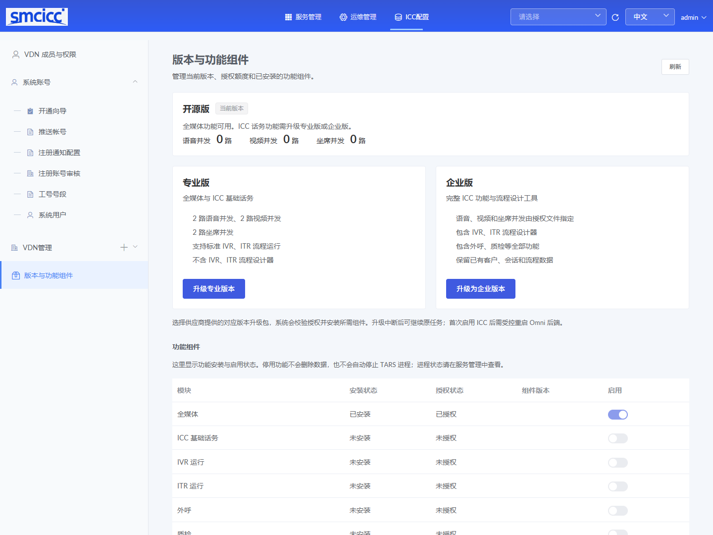
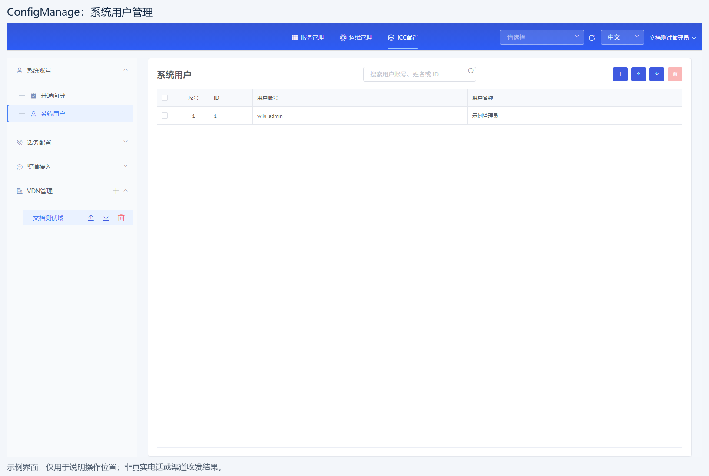
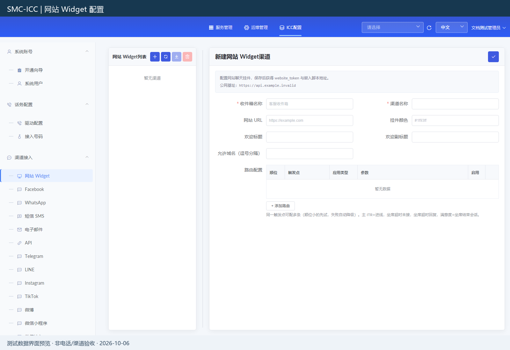
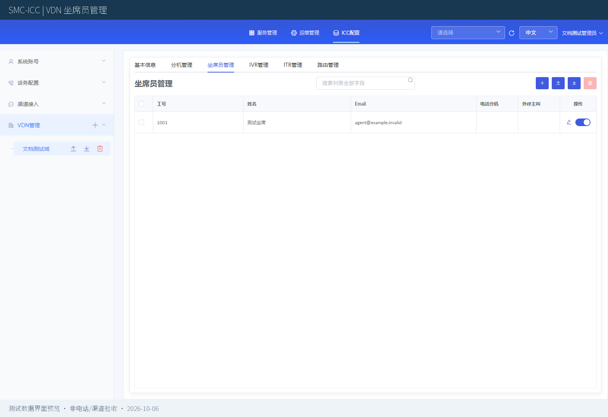

# ConfServer Community

基于 TARS 的全媒体客服配置与运维平台，集中管理 VDN 租户、账号、渠道接入、版本授权和功能组件。

Configuration and operations console for omnichannel customer service on TARS, with VDN tenant management, channel configuration, edition licensing, and component installation.

**[使用文档 / User Guide](https://www.seami.cloud/page?code=user-guide&product=smc-icc)** · **[OmniAgent 坐席工作台](https://github.com/smc-icc/OmniAgent/tree/Community)**

## 项目定位

ConfServer 是 SMC-ICC 的配置管理入口，负责维护客服平台的基础配置，并与 OmniAgent 和 TARS 框架协同工作。

- **管理员**使用 ConfServer 管理租户、账号、渠道和已安装服务。
- **坐席**使用 OmniAgent 接待会话、维护客户资料和处理业务。
- **专业版与企业版**通过有效授权和对应组件扩展 ICC 话务能力。

## 主要功能

| 功能 | 说明 |
|---|---|
| VDN 租户管理 | 维护 VDN 基本信息、父子关系和租户内的坐席员配置，按租户组织客服业务。 |
| 系统账号与权限 | 提供系统用户维护、开通向导及账号管理入口，结合角色和租户范围控制访问。 |
| 多渠道接入配置 | 配置网站 Widget、微信、企业微信、Facebook、WhatsApp、邮件、短信、API 等渠道；具体渠道需配置相应平台账号与回调。 |
| 网站客服接入 | 维护网站渠道、允许域名、欢迎语等参数，为网站客服组件接入提供配置。 |
| 版本与功能组件 | 查看当前版本和授权额度，执行专业版、企业版升级，管理组件的安装与启用状态。 |
| TARS 服务运维 | 查看服务及节点状态，使用发布、配置、日志和监控等管理能力。未安装的 ICC 组件不展示为已安装服务。 |
| 商业话务扩展 | 已授权并安装对应组件后，可配置话务接入、标准 IVR／ITR 运行及相关业务参数。 |
| 企业流程工具接入 | 企业版可安装独立签名的 IVR／ITR 设计器插件，公共工程保留插件安装、验签和加载入口。 |

渠道页面提供配置入口；真实消息收发还取决于平台凭据、回调地址、网络及外部渠道的审核结果。

## 界面预览

以下为 Community 界面及使用文档中的示例截图。演示画面可能包含其他版本的菜单，实际功能以当前授权、已安装组件和用户权限为准。

### 版本与功能组件

查看开源版、专业版与企业版范围，以及组件安装和授权状态。



### 系统用户管理

通过统一列表维护管理账号，提供查询、新增、导入和导出等入口。



### 网站 Widget 渠道配置

维护网站客服渠道、域名、欢迎信息和对应接入参数。



### VDN 坐席员管理

按 VDN 维护坐席员信息，集中管理客服团队的业务账号。



## 版本与授权

| 能力 | 开源版 | 专业版 | 企业版 |
|---|---|---|---|
| Omni 线上全媒体客服 | 支持 | 支持 | 支持 |
| ICC 语音并发 | 不包含 | 2 路 | 按授权文件配置 |
| ICC 视频并发 | 不包含 | 2 路 | 按授权文件配置 |
| ICC 话务坐席并发 | 不包含 | 2 路 | 按授权文件配置 |
| SIP 中继额度 | 不包含 | 2 路 | 按授权文件配置 |
| 标准 IVR／ITR 流程运行 | 不包含 | 支持预置流程；IVR 可更换放音 | 支持 |
| IVR／ITR 可视化设计器 | 不包含 | 不包含 | 安装企业插件后可用 |
| 智能外呼、智能质检 | 不包含 | 不包含 | 安装对应组件后可用 |

ICC 核心话务服务和企业流程设计器通过独立商业组件或插件交付，企业设计器实现源码不包含在此公共工程中。导入授权不等于完成安装；组件完成部署、发布及状态确认后，才展示其服务状态。

## 项目结构

```text
app/                  配置管理后端与业务接口
client/               Vue 配置管理前端
config/               服务配置
midware/、sso/        请求处理与登录认证
tools/                源码检查、签名、打包与交付工具
docs/community/       Community 技术说明与界面截图
```

## 开发与构建

使用 Node.js 22。前端在 `client/` 目录安装依赖并构建：

```bash
cd client
npm ci
npm run build:community
```

实际运行需要准备数据库、Redis、TARS 框架及部署配置。请按使用文档完成安装配置，不直接使用示例中的默认凭据部署公开服务。

## 文档与相关项目

- **[完整使用文档](https://www.seami.cloud/page?code=user-guide&product=smc-icc)**：安装、账号、渠道、VDN 与业务操作说明。
- [Community 技术说明](docs/community/README.md)：开发配置、版本能力及当前实现边界。
- [专业版／企业版升级包制作](docs/community/package-production.md)：签名授权、组件计划与企业插件制作。
- [在线／离线安装交付工具](docs/community/online-offline-installation.md)：安装介质制作及执行方式。
- [OmniAgent](https://github.com/smc-icc/OmniAgent/tree/Community)：与 ConfServer 配套的全媒体坐席工作台。

## License

BSD-3-Clause，见 [LICENSE](LICENSE)。保留原有 TARS 及其他第三方组件的版权、许可证和归属声明。
